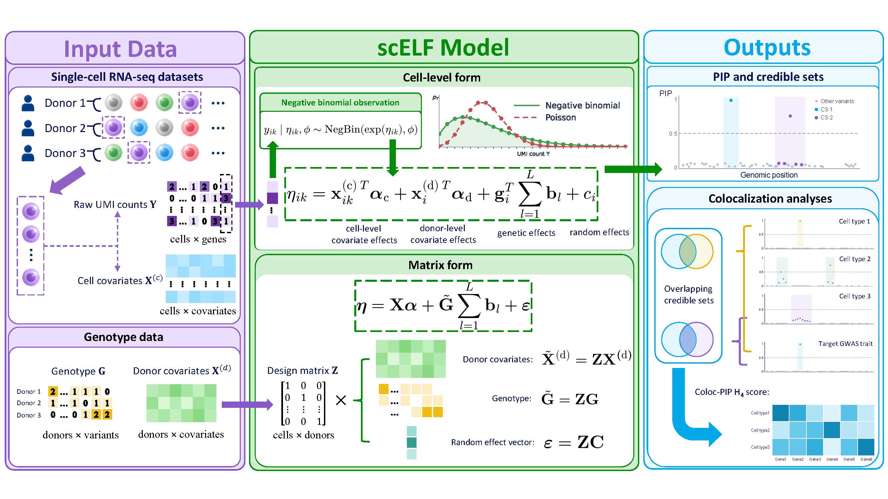

# scELF

A unified statistical framework for single-cell eQTL fine-mapping.

scELF fine-maps candidate cis-regulatory variants using expression counts from individual cells. For one gene in one pre-specified cell type, it combines a negative-binomial count model, covariate adjustment, donor random effects, and a sum-of-single-effects genetic prior. The Python interface returns variant-level posterior inclusion probabilities (PIPs) and credible sets.

## Framework overview

[](assets/images/scelf-framework.png)

*Figure 1. Overview of the scELF framework, reproduced from the manuscript. Cell-level counts and covariates are linked to donor genotypes and covariates through a cell-to-donor incidence matrix. Sparse genetic effects and shared donor random effects explain expression variation; posterior inference produces PIPs and credible sets. Click the figure to view it at full resolution.*

The manuscript figure also illustrates a downstream colocalization branch. The [analysis workflows](analysis-workflows.md) cover OneK1K preparation, four-method fine-mapping, GWAS colocalization, TWAS and locus evidence export. The package provides a separate [PIP colocalization API](colocalization.md).

## What scELF models

- **Cell-level counts:** a negative-binomial likelihood accommodates overdispersed expression without replacing the final response with donor-aggregated expression.
- **Repeated cells from donors:** a shared donor random effect accounts for within-donor dependence.
- **Multiple genetic signals:** the sum-of-single-effects prior supports multiple candidate effects within a cis-region.
- **Uncertainty in variant selection:** PIPs and credible sets summarize approximate posterior evidence rather than association p-values.

Each fit analyzes a single gene and cell type. Cell annotation, candidate-region selection, and input preprocessing are performed before calling the model. scELF does not jointly learn cell types or select eGenes.

## Quick start

Replace `<repository-url>` with the URL of the repository:

```bash
git clone <repository-url> scELF
cd scELF
python -m pip install .
python example/run_b_memory_lst1.py
```

The bundled B memory cell / LST1 example runs one Stage 2 iteration by default. This checks the software and data flow; it is not a converged scientific analysis.

## Read next

- [Model and inference](model.md): the observation model, sparse prior, and two-stage fitting procedure.
- [Installation](installation.md): install the Python package from a checkout.
- [Input data](input-data.md): matrix dimensions, donor alignment, counts, and covariates.
- [Example](example.md): run the bundled data and locate the outputs.
- [Results](results.md) and [diagnostics](diagnostics.md): interpret PIPs and credible sets, and inspect fitting behavior.
- [Parameter reference](parameters.md): constructor, fitting options, and implemented defaults.
- [PIP colocalization](colocalization.md): conditional H3/H4 scoring of aligned PIP vectors.
- [Analysis workflows](analysis-workflows.md): command-line scripts for the OneK1K manuscript analyses.
